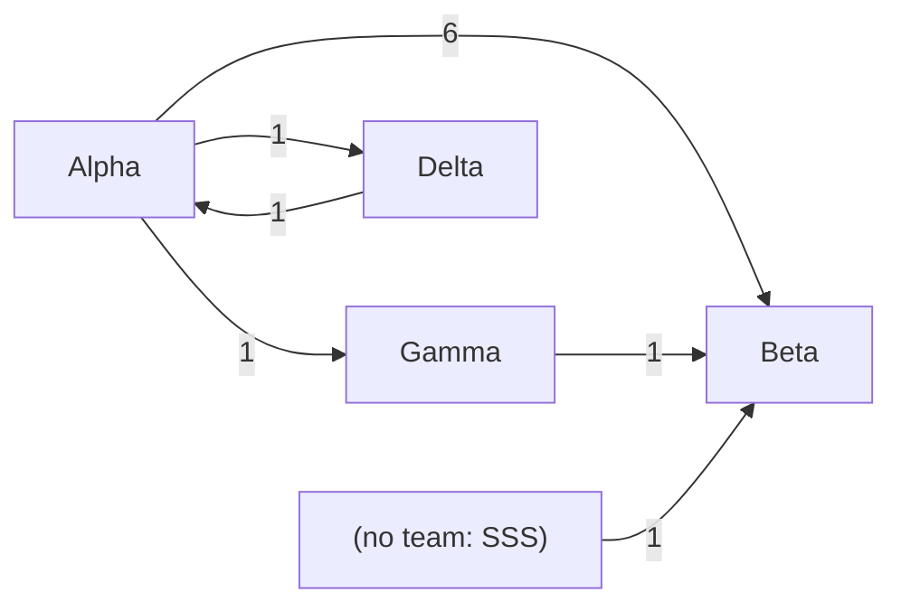
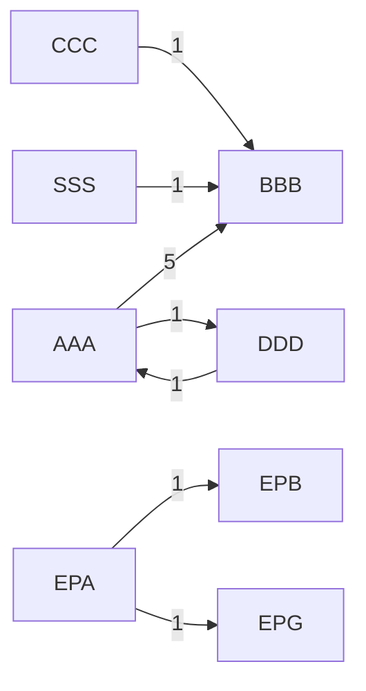
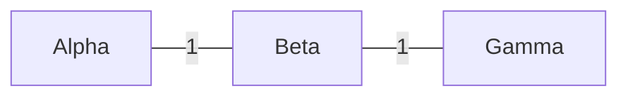

=== rich diagnose ===
[console]
Tickets read: 1000
Recognized columns:
  key     -> Issue key
  type    -> Issue Type
  status  -> Status
  category -> Status Category
  created -> Created
  resolved -> Resolved
  resolution -> Resolution
  category_changed -> Status Category Changed
  team    -> Team
  parent  -> Parent key
Typed link columns: 2 (1 types)
Links by type:
  Blocks                            50  dependency (outward = blocks)
Decomposition links (Epic to another level): 1, counted separately
Projects excluded from the map: 1 (source: setting excluded_projects, shared with the flow report)
Links with excluded project BUG: 1 (waits for the export), counted separately
Links with excluded project BUG: 1 (awaited by the export), counted separately
Links with excluded project BUG: 1 (internal), counted separately
Mode: oriented · distinct dependencies: 25 · to a ticket missing from the export: 8
Projects of linked tickets missing from the export (terminal only):
  ZZZ              8  8 the export waits for it
More than 30% of the links point outside the export: widen the JQL query to the linked projects, otherwise the team on the other side stays unknown.
States that are neither finished, "in progress" nor "to do" (1 tickets): Weird
Tickets without a team: 1

=== rich diagnose scope ===
[console]
Tickets read: 1000
Recognized columns:
  key     -> Issue key
  type    -> Issue Type
  status  -> Status
  category -> Status Category
  created -> Created
  resolved -> Resolved
  resolution -> Resolution
  category_changed -> Status Category Changed
  team    -> Team
  parent  -> Parent key
Typed link columns: 2 (1 types)
Links by type:
  Blocks                            50  dependency (outward = blocks)
Decomposition links (Epic to another level): 1, counted separately
Scope: AAA, BBB (25 tickets; the others are used to locate the other side of the links)
Projects excluded from the map: 1 (source: setting excluded_projects, shared with the flow report)
Links with excluded project BUG: 1 (waits for the export), counted separately
Links with excluded project BUG: 1 (awaited by the export), counted separately
Mode: oriented · distinct dependencies: 16 · to a ticket missing from the export: 6
Projects of linked tickets missing from the export (terminal only):
  ZZZ              6  6 the export waits for it
More than 30% of the links point outside the export: widen the JQL query to the linked projects, otherwise the team on the other side stays unknown.
States that are neither finished, "in progress" nor "to do" (1 tickets): Weird
Tickets without a team: 0

=== rich compute ===
[console]
Report: <WS>/Flux-Lab/rapports/dependances-riche-<DATE>.md

[report dependances-riche-<DATE>.md]
# Dependencies: riche, <DATE>

Export: database · 1000 tickets · 25 distinct dependencies (blocking links, oriented) · 8 to a ticket missing from the export.

> Decomposition links (Epic linked to a ticket of another level): 1, left out of the map (setting portfolio_types). Links between two tickets of this level stay in the map.

> Projects excluded from the map: 1 (source: setting excluded_projects, shared with the flow report)

> Links with excluded project BUG: 1 (waits for the export), left out of the map (setting excluded_projects).

> Links with excluded project BUG: 1 (awaited by the export), left out of the map (setting excluded_projects).

> Links with excluded project BUG: 1 (internal), left out of the map (setting excluded_projects).

> More than 30% of the links point outside the export: the team on the other side is unknown ("outside export"). Widening the JQL query would make the map more complete.

## In brief

- Open dependencies between teams: 11, spread over 6 pairs of teams (1000 tickets in scope). Both sides are in the export and not finished.
- Dependencies with unknown state: 8 (the awaited item is missing from the export, possibly already finished). Counted separately, never as open.
- Busiest pair: Beta waits for Alpha (6 open, 55% of the total).
- Items in progress that wait for another team: 8, plus 3 in progress for more than a year (see "Old blockages").
- Loops between teams: 1 (see "Loops").

## Who depends on whom

Reading: the row waits for the column. "Open": both items are in the export and not finished. "of which between Epics": share of the open ones where both items are portfolio-level (setting portfolio_types); their age measures the life of an Epic, not a wait for work. "Unknown state": the awaited item is missing from the export, the dependent one is not finished. "All": all links, finished ones included.

| Waiting team | Awaited team | Open | of which between Epics | Unknown state | All |
|---|---|---|---|---|---|
| Beta | Alpha | 6 | 2 | 0 | 6 |
| Beta | Gamma | 1 | 0 | 0 | 6 |
| Alpha | Delta | 1 | 0 | 0 | 2 |
| Beta | (no team: SSS) | 1 | 0 | 0 | 1 |
| Delta | Alpha | 1 | 0 | 0 | 1 |
| Gamma | Alpha | 1 | 1 | 0 | 1 |
| Beta | (outside export) | 0 | 0 | 8 | 8 |

Dependencies within a single team: 0 (not detailed).

## Graph of open dependencies

Arrow: from the awaited team to the waiting team; label: open dependencies.

## Loops

Teams that wait on each other, directly or through a chain (open dependencies):

- Alpha waits for Delta waits for Alpha

A loop often signals a split of the work that cuts a single value stream across several teams: more a question of team boundaries than of coordination.

## Current blockages

Items in progress that wait for an unfinished item of another team. Age: since entering in progress (or since creation if none).

| Waiting team | Awaited team | State of the awaited item | Items | of which Epics | Age P50 | Age P85 | Same entry date |
|---|---|---|---|---|---|---|---|
| Beta | Alpha | in progress | 4 | 1 | 20 d | 100 d | 3 of 4 |
| Alpha | Delta | in progress | 1 | 0 | 40 d | 40 d |  |
| Beta | (no team: SSS) | in progress | 1 | 0 | 15 d | 15 d |  |
| Beta | Gamma | not started | 1 | 0 | 30 d | 30 d |  |
| Delta | Alpha | in progress | 1 | 0 | 45 d | 45 d |  |

An awaited item that is "not started" while the dependent one is in progress is the most costly case: the work started before its condition was planned.

Ages to check before reading anything: in Beta waits for Alpha, most of the items entered in progress on the same day. This is probably the sign of a bulk status change (planning, migration), not of a real start: the age may then overestimate the wait.

### Waits on an item outside the export

Items in progress whose awaited item is missing from the export: it is impossible to know whether it is finished. Check in Jira before seeing a blockage in it. Jira project of the awaited item.

| Waiting team | Awaited project | Items | Age P50 | Age P85 |
|---|---|---|---|---|
| Beta | ZZZ | 8 | 20 d | 30 d |

### Old Epics: alive or abandoned?

Epics open for more than 365 days and caught in an open link between teams. "Alive": one of their children changed state (if open) or was delivered in the last 90 days; a closure by rejection or cancellation does not count (it is often a clean-up). "Inactive children": children exist but have not moved since. "No delivery child": no child visible in the export, or only portfolio-level children (RN Task); an RN Task or a closure by rejection does not count as a delivery (the export keeps only open or recently resolved tickets). The links of an Epic that is not alive probably describe an abandoned plan rather than a wait.

Total: 1 alive, 2 with inactive children, 1 with no delivery child.

| Team | Alive | Inactive children | No delivery child |
|---|---|---|---|
| Alpha | 1 | 1 | 0 |
| Beta | 0 | 0 | 1 |
| Gamma | 0 | 1 | 0 |

### Old blockages

In progress for more than 365 days: probably abandoned or badly closed tickets, to clean up rather than unblock. Excluded from the previous table.

| Waiting team | Awaited team | Items | Oldest |
|---|---|---|---|
| Beta | Alpha | 2 | 700 d |
| Gamma | Alpha | 1 | 800 d |

## Effect on lead time (last 26 weeks)

Comparison at equal ticket type. External dependency: the item was waiting on an item of another known team (neither outside the export nor without a team). Lead time counted from creation, backlog wait included. A type appears only if it has at least 5 items on each side.

| Type | With dependency: count | P50 | P85 | Without: count | P50 | P85 |
|---|---|---|---|---|---|---|
| Story | 5 | 10 d | 10 d | 12 | 20 d | 20 d |

Correlation, not causation: items with a dependency are often also bigger or more uncertain. The gap is a question to ask the teams, not a measure of the cost of dependencies. P85 is fragile for: Story (fewer than 30 items with a dependency).

=== rich compute keys ===
[console]
Report: <WS>/Flux-Lab/rapports/dependances-cles-<DATE>.md

Old Epics that are not alive (3). Jira query to see all their children, finished ones included, sorted by last update (terminal only):
  parent in (EPA-2, EPB-1, EPG-1) ORDER BY updated DESC

Current blockages (terminal only, nothing is written):
  EPG-1 (Gamma) waits for EPA-2 (Alpha, in progress) for 800 d
  EPB-1 (Beta) waits for EPA-1 (Alpha, in progress) for 700 d
  BBB-12 (Beta) waits for AAA-11 (Alpha, in progress) for 400 d
  BBB-4 (Beta) waits for AAA-4 (Alpha, in progress) for 100 d
  DDD-2 (Delta) waits for AAA-6 (Alpha, in progress) for 45 d
  AAA-5 (Alpha) waits for DDD-1 (Delta, in progress) for 40 d
  BBC-21 (Beta) waits for ZZZ-21 ((outside export), outside export) for 31 d
  BBB-5 (Beta) waits for CCC-1 (Gamma, not started) for 30 d
  BBC-20 (Beta) waits for ZZZ-20 ((outside export), outside export) for 30 d
  BBB-11 (Beta) waits for ZZZ-11 ((outside export), outside export) for 21 d
  BBB-1 (Beta) waits for AAA-1 (Alpha, in progress) for 20 d
  BBB-10 (Beta) waits for ZZZ-10 ((outside export), outside export) for 20 d
  BBB-2 (Beta) waits for AAA-2 (Alpha, in progress) for 20 d
  BBB-3 (Beta) waits for AAA-3 (Alpha, in progress) for 20 d
  BBB-9 (Beta) waits for ZZZ-9 ((outside export), outside export) for 19 d
  BBB-8 (Beta) waits for ZZZ-8 ((outside export), outside export) for 18 d
  BBB-7 (Beta) waits for ZZZ-7 ((outside export), outside export) for 17 d
  BBB-6 (Beta) waits for ZZZ-6 ((outside export), outside export) for 16 d
  BBB-14 (Beta) waits for SSS-1 ((no team: SSS), in progress) for 15 d

[report dependances-cles-<DATE>.md]
# Dependencies: cles, <DATE>

Export: database · 1000 tickets · 25 distinct dependencies (blocking links, oriented) · 8 to a ticket missing from the export.

> Decomposition links (Epic linked to a ticket of another level): 1, left out of the map (setting portfolio_types). Links between two tickets of this level stay in the map.

> Projects excluded from the map: 1 (source: setting excluded_projects, shared with the flow report)

> Links with excluded project BUG: 1 (waits for the export), left out of the map (setting excluded_projects).

> Links with excluded project BUG: 1 (awaited by the export), left out of the map (setting excluded_projects).

> Links with excluded project BUG: 1 (internal), left out of the map (setting excluded_projects).

> More than 30% of the links point outside the export: the team on the other side is unknown ("outside export"). Widening the JQL query would make the map more complete.

## In brief

- Open dependencies between teams: 11, spread over 6 pairs of teams (1000 tickets in scope). Both sides are in the export and not finished.
- Dependencies with unknown state: 8 (the awaited item is missing from the export, possibly already finished). Counted separately, never as open.
- Busiest pair: Beta waits for Alpha (6 open, 55% of the total).
- Items in progress that wait for another team: 8, plus 3 in progress for more than a year (see "Old blockages").
- Loops between teams: 1 (see "Loops").

## Who depends on whom

Reading: the row waits for the column. "Open": both items are in the export and not finished. "of which between Epics": share of the open ones where both items are portfolio-level (setting portfolio_types); their age measures the life of an Epic, not a wait for work. "Unknown state": the awaited item is missing from the export, the dependent one is not finished. "All": all links, finished ones included.

| Waiting team | Awaited team | Open | of which between Epics | Unknown state | All |
|---|---|---|---|---|---|
| Beta | Alpha | 6 | 2 | 0 | 6 |
| Beta | Gamma | 1 | 0 | 0 | 6 |
| Alpha | Delta | 1 | 0 | 0 | 2 |
| Beta | (no team: SSS) | 1 | 0 | 0 | 1 |
| Delta | Alpha | 1 | 0 | 0 | 1 |
| Gamma | Alpha | 1 | 1 | 0 | 1 |
| Beta | (outside export) | 0 | 0 | 8 | 8 |

Dependencies within a single team: 0 (not detailed).

## Graph of open dependencies

Arrow: from the awaited team to the waiting team; label: open dependencies.

## Loops

Teams that wait on each other, directly or through a chain (open dependencies):

- Alpha waits for Delta waits for Alpha

A loop often signals a split of the work that cuts a single value stream across several teams: more a question of team boundaries than of coordination.

## Current blockages

Items in progress that wait for an unfinished item of another team. Age: since entering in progress (or since creation if none).

| Waiting team | Awaited team | State of the awaited item | Items | of which Epics | Age P50 | Age P85 | Same entry date |
|---|---|---|---|---|---|---|---|
| Beta | Alpha | in progress | 4 | 1 | 20 d | 100 d | 3 of 4 |
| Alpha | Delta | in progress | 1 | 0 | 40 d | 40 d |  |
| Beta | (no team: SSS) | in progress | 1 | 0 | 15 d | 15 d |  |
| Beta | Gamma | not started | 1 | 0 | 30 d | 30 d |  |
| Delta | Alpha | in progress | 1 | 0 | 45 d | 45 d |  |

An awaited item that is "not started" while the dependent one is in progress is the most costly case: the work started before its condition was planned.

Ages to check before reading anything: in Beta waits for Alpha, most of the items entered in progress on the same day. This is probably the sign of a bulk status change (planning, migration), not of a real start: the age may then overestimate the wait.

### Waits on an item outside the export

Items in progress whose awaited item is missing from the export: it is impossible to know whether it is finished. Check in Jira before seeing a blockage in it. Jira project of the awaited item.

| Waiting team | Awaited project | Items | Age P50 | Age P85 |
|---|---|---|---|---|
| Beta | ZZZ | 8 | 20 d | 30 d |

### Old Epics: alive or abandoned?

Epics open for more than 365 days and caught in an open link between teams. "Alive": one of their children changed state (if open) or was delivered in the last 90 days; a closure by rejection or cancellation does not count (it is often a clean-up). "Inactive children": children exist but have not moved since. "No delivery child": no child visible in the export, or only portfolio-level children (RN Task); an RN Task or a closure by rejection does not count as a delivery (the export keeps only open or recently resolved tickets). The links of an Epic that is not alive probably describe an abandoned plan rather than a wait.

Total: 1 alive, 2 with inactive children, 1 with no delivery child.

| Team | Alive | Inactive children | No delivery child |
|---|---|---|---|
| Alpha | 1 | 1 | 0 |
| Beta | 0 | 0 | 1 |
| Gamma | 0 | 1 | 0 |

### Old blockages

In progress for more than 365 days: probably abandoned or badly closed tickets, to clean up rather than unblock. Excluded from the previous table.

| Waiting team | Awaited team | Items | Oldest |
|---|---|---|---|
| Beta | Alpha | 2 | 700 d |
| Gamma | Alpha | 1 | 800 d |

## Effect on lead time (last 26 weeks)

Comparison at equal ticket type. External dependency: the item was waiting on an item of another known team (neither outside the export nor without a team). Lead time counted from creation, backlog wait included. A type appears only if it has at least 5 items on each side.

| Type | With dependency: count | P50 | P85 | Without: count | P50 | P85 |
|---|---|---|---|---|---|---|
| Story | 5 | 10 d | 10 d | 12 | 20 d | 20 d |

Correlation, not causation: items with a dependency are often also bigger or more uncertain. The gap is a question to ask the teams, not a measure of the cost of dependencies. P85 is fragile for: Story (fewer than 30 items with a dependency).

=== rich compute by project ===
[console]
Report: <WS>/Flux-Lab/rapports/dependances-projets-projets-<DATE>.md

[report dependances-projets-projets-<DATE>.md]
# Dependencies: projets, <DATE>

Export: database · 1000 tickets · 25 distinct dependencies (blocking links, oriented) · 8 to a ticket missing from the export.

> Decomposition links (Epic linked to a ticket of another level): 1, left out of the map (setting portfolio_types). Links between two tickets of this level stay in the map.

> Projects excluded from the map: 1 (source: setting excluded_projects, shared with the flow report)

> Links with excluded project BUG: 1 (waits for the export), left out of the map (setting excluded_projects).

> Links with excluded project BUG: 1 (awaited by the export), left out of the map (setting excluded_projects).

> Links with excluded project BUG: 1 (internal), left out of the map (setting excluded_projects).

> More than 30% of the links point outside the export: the team on the other side is unknown ("outside export"). Widening the JQL query would make the map more complete.

## In brief

- Open dependencies between projects: 11, spread over 7 pairs of projects (1000 tickets in scope). Both sides are in the export and not finished.
- Dependencies with unknown state: 8 (the awaited item is missing from the export, possibly already finished). Counted separately, never as open.
- Busiest pair: BBB waits for AAA (5 open, 45% of the total).
- Items in progress that wait for another project: 8, plus 3 in progress for more than a year (see "Old blockages").
- Loops between projects: 1 (see "Loops").

## Who depends on whom

Reading: the row waits for the column. "Open": both items are in the export and not finished. "of which between Epics": share of the open ones where both items are portfolio-level (setting portfolio_types); their age measures the life of an Epic, not a wait for work. "Unknown state": the awaited item is missing from the export, the dependent one is not finished. "All": all links, finished ones included.

| Waiting project | Awaited project | Open | of which between Epics | Unknown state | All |
|---|---|---|---|---|---|
| BBB | AAA | 5 | 1 | 0 | 5 |
| AAA | DDD | 1 | 0 | 0 | 2 |
| BBB | CCC | 1 | 0 | 0 | 1 |
| BBB | SSS | 1 | 0 | 0 | 1 |
| DDD | AAA | 1 | 0 | 0 | 1 |
| EPB | EPA | 1 | 1 | 0 | 1 |
| EPG | EPA | 1 | 1 | 0 | 1 |
| BBB | ZZZ | 0 | 0 | 6 | 6 |
| BBC | ZZZ | 0 | 0 | 2 | 2 |
| LLB | LLC | 0 | 0 | 0 | 5 |

Dependencies within a single project: 0 (not detailed).

## Graph of open dependencies

Arrow: from the awaited project to the waiting project; label: open dependencies.

## Loops

Projects that wait on each other, directly or through a chain (open dependencies):

- AAA waits for DDD waits for AAA

A loop often signals a split of the work that cuts a single value stream across several teams: more a question of team boundaries than of coordination.

## Current blockages

Items in progress that wait for an unfinished item of another project. Age: since entering in progress (or since creation if none).

| Waiting project | Awaited project | State of the awaited item | Items | of which Epics | Age P50 | Age P85 | Same entry date |
|---|---|---|---|---|---|---|---|
| BBB | AAA | in progress | 4 | 1 | 20 d | 100 d | 3 of 4 |
| AAA | DDD | in progress | 1 | 0 | 40 d | 40 d |  |
| BBB | CCC | not started | 1 | 0 | 30 d | 30 d |  |
| BBB | SSS | in progress | 1 | 0 | 15 d | 15 d |  |
| DDD | AAA | in progress | 1 | 0 | 45 d | 45 d |  |

An awaited item that is "not started" while the dependent one is in progress is the most costly case: the work started before its condition was planned.

Ages to check before reading anything: in BBB waits for AAA, most of the items entered in progress on the same day. This is probably the sign of a bulk status change (planning, migration), not of a real start: the age may then overestimate the wait.

### Waits on an item outside the export

Items in progress whose awaited item is missing from the export: it is impossible to know whether it is finished. Check in Jira before seeing a blockage in it. Jira project of the awaited item.

| Waiting project | Awaited project | Items | Age P50 | Age P85 |
|---|---|---|---|---|
| BBB | ZZZ | 6 | 18 d | 20 d |
| BBC | ZZZ | 2 | 30 d | 31 d |

### Old Epics: alive or abandoned?

Epics open for more than 365 days and caught in an open link between projects. "Alive": one of their children changed state (if open) or was delivered in the last 90 days; a closure by rejection or cancellation does not count (it is often a clean-up). "Inactive children": children exist but have not moved since. "No delivery child": no child visible in the export, or only portfolio-level children (RN Task); an RN Task or a closure by rejection does not count as a delivery (the export keeps only open or recently resolved tickets). The links of an Epic that is not alive probably describe an abandoned plan rather than a wait.

Total: 1 alive, 2 with inactive children, 1 with no delivery child.

| Team | Alive | Inactive children | No delivery child |
|---|---|---|---|
| EPA | 1 | 1 | 0 |
| EPB | 0 | 0 | 1 |
| EPG | 0 | 1 | 0 |

### Old blockages

In progress for more than 365 days: probably abandoned or badly closed tickets, to clean up rather than unblock. Excluded from the previous table.

| Waiting project | Awaited project | Items | Oldest |
|---|---|---|---|
| BBB | AAA | 1 | 400 d |
| EPB | EPA | 1 | 700 d |
| EPG | EPA | 1 | 800 d |

## Effect on lead time (last 26 weeks)

Comparison at equal ticket type. External dependency: the item was waiting on an item of another project. Lead time counted from creation, backlog wait included. A type appears only if it has at least 5 items on each side.

| Type | With dependency: count | P50 | P85 | Without: count | P50 | P85 |
|---|---|---|---|---|---|---|
| Story | 5 | 10 d | 10 d | 12 | 20 d | 20 d |

Correlation, not causation: items with a dependency are often also bigger or more uncertain. The gap is a question to ask the teams, not a measure of the cost of dependencies. P85 is fragile for: Story (fewer than 30 items with a dependency).

=== unoriented diagnose ===
[console]
Tickets read: 5
Recognized columns:
  key     -> Issue key
  type    -> Issue Type
  status  -> Status
  category -> Status Category
  created -> Created
  resolved -> Resolved
  resolution -> Resolution
  category_changed -> Status Category Changed
  team    -> Team
  parent  -> Parent key
Untyped link columns: Linked Issues
Links by type:
  (no type)                          5  no type
Projects excluded from the map: 1 (source: setting excluded_projects, shared with the flow report)
Mode: not oriented · distinct dependencies: 3 · to a ticket missing from the export: 0
Tickets without a team: 0

=== unoriented compute ===
[console]
Report: <WS>/Flux-Lab/rapports/dependances-sans-<DATE>.md

[report dependances-sans-<DATE>.md]
# Dependencies: sans, <DATE>

Export: database · 5 tickets · 3 distinct dependencies (untyped links, not oriented) · 0 to a ticket missing from the export.

> The links have no type: it is impossible to tell a blockage from a simple relation, or who waits for whom. The figures count links, not blockages. For blockages, typed link columns are needed ("Inward/Outward issue link (Blocks)").

> Projects excluded from the map: 1 (source: setting excluded_projects, shared with the flow report)

## In brief

- Open dependencies between teams: 2, spread over 2 pairs of teams (5 tickets in scope). Both sides are in the export and not finished.
- Busiest pair: Alpha and Beta (1 open links, 50% of the total).

## Who depends on whom

Links between teams where at least one side is not finished (column "All": finished ones included).

| Team | Team | Open | of which between Epics | Unknown state | All |
|---|---|---|---|---|---|
| Alpha | Beta | 1 | 0 | 0 | 1 |
| Beta | Gamma | 1 | 0 | 0 | 1 |
| Alpha | Delta | 0 | 0 | 0 | 1 |

Dependencies within a single team: 0 (not detailed).

## Graph of open dependencies

Line: open links between two teams.

## Effect on lead time (last 26 weeks)

Comparison at equal ticket type. External dependency: the item was waiting on an item of another known team (neither outside the export nor without a team). Lead time counted from creation, backlog wait included. A type appears only if it has at least 5 items on each side.

No type has enough items on both sides to compare (with/without: Story 1/0).

=== empty compute ===
[console]
Report: <WS>/Flux-Lab/rapports/dependances-vide-<DATE>.md

[report dependances-vide-<DATE>.md]
# Dependencies: vide, <DATE>

Export: database · 2 tickets · 0 distinct dependencies (blocking links, oriented) · 0 to a ticket missing from the export.

> Projects excluded from the map: 1 (source: setting excluded_projects, shared with the flow report)

## In brief

- Open dependencies between teams: 0, spread over 0 pairs of teams (2 tickets in scope). Both sides are in the export and not finished.
- Items in progress that wait for another team: 0.

## Who depends on whom

Reading: the row waits for the column. "Open": both items are in the export and not finished. "of which between Epics": share of the open ones where both items are portfolio-level (setting portfolio_types); their age measures the life of an Epic, not a wait for work. "Unknown state": the awaited item is missing from the export, the dependent one is not finished. "All": all links, finished ones included.

No dependencies between teams in the export.

Dependencies within a single team: 0 (not detailed).

## Current blockages

Items in progress that wait for an unfinished item of another team. Age: since entering in progress (or since creation if none).

No item in progress waits for another team.

## Effect on lead time (last 26 weeks)

Comparison at equal ticket type. External dependency: the item was waiting on an item of another known team (neither outside the export nor without a team). Lead time counted from creation, backlog wait included. A type appears only if it has at least 5 items on each side.

No type has enough items on both sides to compare (with/without: none).

=== two exports diagnose ===
[console]
Tickets read: 3
Recognized columns:
  key     -> Issue key
  type    -> missing
  status  -> Status
  category -> missing
  created -> Created
  resolved -> missing
  resolution -> missing
  category_changed -> missing
  team    -> Team
  parent  -> missing
Typed link columns: 2 (2 types)
Untyped link columns: Linked Issues
Links by type:
  (no type)                          1  no type
  Blocks                             1  dependency (outward = blocks)
  Relates                            1  ignored
Projects excluded from the map: 1 (source: setting excluded_projects, shared with the flow report)
Mode: oriented · distinct dependencies: 1 · to a ticket missing from the export: 0
States that are neither finished, "in progress" nor "to do" (1 tickets): Weird
  Add the "Status Category" column to the Jira view: it classifies the states of all workflows.
Tickets without a team: 0

=== no link columns diagnose ===
[console]
Tickets read: 1
Recognized columns:
  key     -> Issue key
  type    -> missing
  status  -> Status
  category -> missing
  created -> missing
  resolved -> missing
  resolution -> missing
  category_changed -> missing
  team    -> Team
  parent  -> missing
No link columns: add "Linked Issues" to the Jira view and export again.

=== no link columns compute ===
[console]
No link columns in the export: run the diagnose command first.

