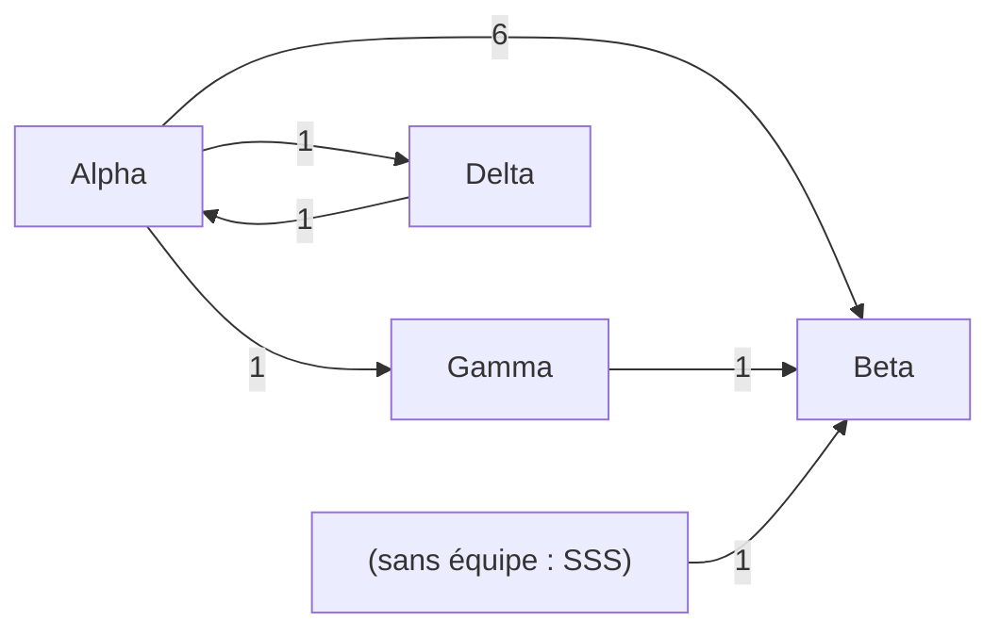
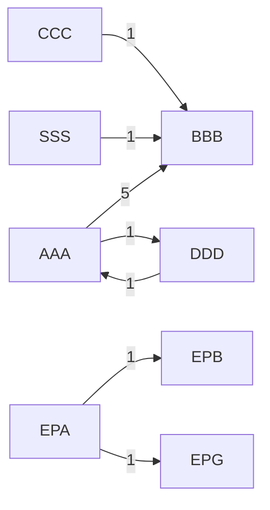
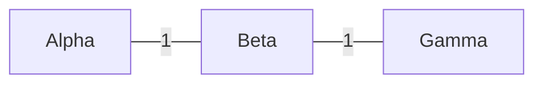

=== rich diagnose ===
[console]
Tickets lus : 1000
Colonnes reconnues :
  cle     -> Issue key
  type    -> Issue Type
  etat    -> Status
  categorie -> Status Category
  cree    -> Created
  resolu  -> Resolved
  motif   -> Resolution
  debut   -> Status Category Changed
  equipe  -> Team
  parent  -> Parent key
Colonnes de liens typées : 2 (1 types)
Liens par type :
  Blocks                            50  dépendance (sortant = bloque)
Liens de décomposition (Epic vers un autre niveau) : 1, comptés à part
Liens avec le projet exclu BUG : 1 (attend l'export), comptés à part
Liens avec le projet exclu BUG : 1 (attendu par l'export), comptés à part
Liens avec le projet exclu BUG : 1 (interne), comptés à part
Mode : orienté · dépendances distinctes : 25 · vers un ticket absent de l'export : 8
Projets des tickets liés absents de l'export (Terminal seulement) :
  ZZZ              8  8 l'export l'attend
Plus de 30 % des liens sortent de l'export : élargissez la requête JQL aux projets liés, sinon l'équipe de l'autre côté reste inconnue.
États non terminés ni « en cours » ni « à faire » (1 tickets) : Weird
Attention : 1000 tickets, un nombre rond. L'export a probablement atteint la limite de Jira et des tickets manquent : réduisez la requête.
Tickets sans équipe : 1

=== rich diagnose scope ===
[console]
Tickets lus : 1000
Colonnes reconnues :
  cle     -> Issue key
  type    -> Issue Type
  etat    -> Status
  categorie -> Status Category
  cree    -> Created
  resolu  -> Resolved
  motif   -> Resolution
  debut   -> Status Category Changed
  equipe  -> Team
  parent  -> Parent key
Colonnes de liens typées : 2 (1 types)
Liens par type :
  Blocks                            50  dépendance (sortant = bloque)
Liens de décomposition (Epic vers un autre niveau) : 1, comptés à part
Périmètre : AAA, BBB (25 tickets ; les autres servent à situer l'autre côté des liens)
Liens avec le projet exclu BUG : 1 (attend l'export), comptés à part
Liens avec le projet exclu BUG : 1 (attendu par l'export), comptés à part
Mode : orienté · dépendances distinctes : 16 · vers un ticket absent de l'export : 6
Projets des tickets liés absents de l'export (Terminal seulement) :
  ZZZ              6  6 l'export l'attend
Plus de 30 % des liens sortent de l'export : élargissez la requête JQL aux projets liés, sinon l'équipe de l'autre côté reste inconnue.
États non terminés ni « en cours » ni « à faire » (1 tickets) : Weird
Attention : 1000 tickets, un nombre rond. L'export a probablement atteint la limite de Jira et des tickets manquent : réduisez la requête.
Tickets sans équipe : 0

=== rich compute ===
[console]
Rapport : <WS>/Flux-Lab/rapports/dependances-riche-<DATE>.md

[report dependances-riche-<DATE>.md]
# Dépendances : riche, <DATE>

Export : riche.csv · 1000 tickets · 25 dépendances distinctes (liens de blocage, orientés) · 8 vers un ticket absent de l'export.

> **Export probablement tronqué** : riche.csv (1000) tickets, un nombre rond qui correspond à une limite d'export de Jira. Des tickets manquent (les plus anciens si la requête trie par date décroissante) : ne pas lire cette carte, découper la requête en lots plus petits.

> Liens de décomposition (Epic relié à un ticket d'un autre niveau) : 1, hors de la carte (réglage portfolio_types). Les liens entre deux tickets de ce niveau restent dans la carte.

> Liens avec le projet exclu BUG : 1 (attend l'export), hors de la carte (réglage excluded_projects).

> Liens avec le projet exclu BUG : 1 (attendu par l'export), hors de la carte (réglage excluded_projects).

> Liens avec le projet exclu BUG : 1 (interne), hors de la carte (réglage excluded_projects).

> Plus de 30 % des liens pointent hors de l'export : l'équipe de l'autre côté est inconnue (« hors export »). Élargir la requête JQL rendrait la carte plus complète.

## En bref

- Dépendances ouvertes entre équipes : 11, réparties sur 6 paires d'équipes (1000 tickets dans le périmètre). Les deux côtés sont dans l'export et non terminés.
- Dépendances à état inconnu : 8 (l'élément attendu est absent de l'export, peut-être déjà terminé). Comptées à part, jamais comme ouvertes.
- Paire la plus chargée : Beta attend Alpha (6 ouvertes, 55 % du total).
- Éléments en cours qui attendent une autre équipe : 8, plus 3 en cours depuis plus d'un an (voir « Blocages anciens »).
- Boucles entre équipes : 1 (voir « Boucles »).

## Qui dépend de qui

Lecture : la ligne attend la colonne. « Ouvertes » : les deux éléments sont dans l'export et non terminés. « dont entre Epics » : part des ouvertes où les deux éléments sont de niveau portefeuille (réglage portfolio_types) ; leur âge mesure la vie d'une épopée, pas une attente de travail. « État inconnu » : l'élément attendu est absent de l'export, le dépendant n'est pas terminé. « Toutes » : tous les liens, terminés compris.

| Équipe qui attend | Équipe attendue | Ouvertes | dont entre Epics | État inconnu | Toutes |
|---|---|---|---|---|---|
| Beta | Alpha | 6 | 2 | 0 | 6 |
| Beta | Gamma | 1 | 0 | 0 | 6 |
| Alpha | Delta | 1 | 0 | 0 | 2 |
| Beta | (sans équipe : SSS) | 1 | 0 | 0 | 1 |
| Delta | Alpha | 1 | 0 | 0 | 1 |
| Gamma | Alpha | 1 | 1 | 0 | 1 |
| Beta | (hors export) | 0 | 0 | 8 | 8 |

Dépendances internes à une même équipe : 0 (non détaillées).

## Graphe des dépendances ouvertes

Flèche : de l'équipe attendue vers l'équipe qui attend ; étiquette : dépendances ouvertes.

## Boucles

Équipes qui s'attendent mutuellement, directement ou par une chaîne (dépendances ouvertes) :

- Alpha attend Delta attend Alpha

Une boucle signale souvent un découpage du travail qui coupe un même flux de valeur entre plusieurs équipes : une question de frontières d'équipe plus que de coordination.

## Blocages en cours

Éléments en cours qui attendent un élément non terminé d'une autre équipe. Âge : depuis l'entrée en cours (ou la création à défaut).

| Équipe qui attend | Équipe attendue | État de l'élément attendu | Éléments | dont Epics | Âge P50 | Âge P85 | Même date d'entrée |
|---|---|---|---|---|---|---|---|
| Beta | Alpha | en cours | 4 | 1 | 20 j | 100 j | 3 sur 4 |
| Alpha | Delta | en cours | 1 | 0 | 40 j | 40 j |  |
| Beta | (sans équipe : SSS) | en cours | 1 | 0 | 15 j | 15 j |  |
| Beta | Gamma | pas commencé | 1 | 0 | 30 j | 30 j |  |
| Delta | Alpha | en cours | 1 | 0 | 45 j | 45 j |  |

Un élément attendu « pas commencé » alors que le dépendant est en cours est le cas le plus coûteux : le travail a démarré avant que sa condition soit planifiée.

Âges à vérifier avant toute lecture : dans Beta attend Alpha, la plupart des éléments sont entrés en cours le même jour. C'est le signe probable d'un changement de statut groupé (planification, migration), pas d'un démarrage réel : l'âge peut alors surestimer l'attente.

### Attentes vers un élément hors export

Éléments en cours dont l'élément attendu est absent de l'export : impossible de savoir s'il est terminé. À vérifier dans Jira avant d'y voir un blocage. Projet Jira de l'élément attendu.

| Équipe qui attend | Projet attendu | Éléments | Âge P50 | Âge P85 |
|---|---|---|---|---|
| Beta | ZZZ | 8 | 20 j | 30 j |

### Epics anciens : vivants ou abandonnés ?

Epics ouverts depuis plus de 365 jours et pris dans un lien ouvert entre équipes. « Vivant » : un de leurs enfants a changé d'état (s'il est ouvert) ou a été livré dans les 90 derniers jours ; une clôture par rejet ou annulation ne compte pas (c'est souvent un nettoyage). « Enfants inactifs » : des enfants existent mais n'ont pas bougé depuis. « Sans enfant de livraison » : aucun enfant visible dans l'export, ou seulement des enfants de niveau portefeuille (RN Task) ; une RN Task ou une clôture par rejet ne compte pas comme livraison (l'export ne garde que les tickets ouverts ou résolus récemment). Les liens d'un Epic qui n'est pas vivant décrivent probablement un plan abandonné plutôt qu'une attente.

Total : 1 vivants, 2 aux enfants inactifs, 1 sans enfant de livraison.

| Équipe | Vivants | Enfants inactifs | Sans enfant de livraison |
|---|---|---|---|
| Alpha | 1 | 1 | 0 |
| Beta | 0 | 0 | 1 |
| Gamma | 0 | 1 | 0 |

### Blocages anciens

En cours depuis plus de 365 jours : probablement des tickets abandonnés ou mal clos, à nettoyer plutôt qu'à débloquer. Exclus du tableau précédent.

| Équipe qui attend | Équipe attendue | Éléments | Le plus ancien |
|---|---|---|---|
| Beta | Alpha | 2 | 700 j |
| Gamma | Alpha | 1 | 800 j |

## Effet sur le lead time (26 dernières semaines)

Comparaison à type de ticket égal. Dépendance externe : l'élément attendait un élément d'une autre équipe connue (ni hors export, ni sans équipe). Lead time compté depuis la création, attente en backlog comprise. Un type n'apparaît que s'il compte au moins 5 éléments de chaque côté.

| Type | Avec dépendance : nombre | P50 | P85 | Sans : nombre | P50 | P85 |
|---|---|---|---|---|---|---|
| Story | 5 | 10 j | 10 j | 12 | 20 j | 20 j |

Corrélation, pas causalité : les éléments avec dépendance sont souvent aussi plus gros ou plus incertains. L'écart est une question à poser aux équipes, pas une mesure du coût des dépendances. P85 fragile pour : Story (moins de 30 éléments avec dépendance).

=== rich compute keys ===
[console]
Rapport : <WS>/Flux-Lab/rapports/dependances-cles-<DATE>.md

Epics anciens non vivants (3). Requête Jira pour voir tous leurs enfants, terminés compris, triés par dernière mise à jour (Terminal seulement) :
  parent in (EPA-2, EPB-1, EPG-1) ORDER BY updated DESC

Blocages en cours (Terminal seulement, rien n'est écrit) :
  EPG-1 (Gamma) attend EPA-2 (Alpha, en cours) depuis 800 j
  EPB-1 (Beta) attend EPA-1 (Alpha, en cours) depuis 700 j
  BBB-12 (Beta) attend AAA-11 (Alpha, en cours) depuis 400 j
  BBB-4 (Beta) attend AAA-4 (Alpha, en cours) depuis 100 j
  DDD-2 (Delta) attend AAA-6 (Alpha, en cours) depuis 45 j
  AAA-5 (Alpha) attend DDD-1 (Delta, en cours) depuis 40 j
  BBC-21 (Beta) attend ZZZ-21 ((hors export), hors export) depuis 31 j
  BBB-5 (Beta) attend CCC-1 (Gamma, pas commencé) depuis 30 j
  BBC-20 (Beta) attend ZZZ-20 ((hors export), hors export) depuis 30 j
  BBB-11 (Beta) attend ZZZ-11 ((hors export), hors export) depuis 21 j
  BBB-1 (Beta) attend AAA-1 (Alpha, en cours) depuis 20 j
  BBB-10 (Beta) attend ZZZ-10 ((hors export), hors export) depuis 20 j
  BBB-2 (Beta) attend AAA-2 (Alpha, en cours) depuis 20 j
  BBB-3 (Beta) attend AAA-3 (Alpha, en cours) depuis 20 j
  BBB-9 (Beta) attend ZZZ-9 ((hors export), hors export) depuis 19 j
  BBB-8 (Beta) attend ZZZ-8 ((hors export), hors export) depuis 18 j
  BBB-7 (Beta) attend ZZZ-7 ((hors export), hors export) depuis 17 j
  BBB-6 (Beta) attend ZZZ-6 ((hors export), hors export) depuis 16 j
  BBB-14 (Beta) attend SSS-1 ((sans équipe : SSS), en cours) depuis 15 j

[report dependances-cles-<DATE>.md]
# Dépendances : cles, <DATE>

Export : riche.csv · 1000 tickets · 25 dépendances distinctes (liens de blocage, orientés) · 8 vers un ticket absent de l'export.

> **Export probablement tronqué** : riche.csv (1000) tickets, un nombre rond qui correspond à une limite d'export de Jira. Des tickets manquent (les plus anciens si la requête trie par date décroissante) : ne pas lire cette carte, découper la requête en lots plus petits.

> Liens de décomposition (Epic relié à un ticket d'un autre niveau) : 1, hors de la carte (réglage portfolio_types). Les liens entre deux tickets de ce niveau restent dans la carte.

> Liens avec le projet exclu BUG : 1 (attend l'export), hors de la carte (réglage excluded_projects).

> Liens avec le projet exclu BUG : 1 (attendu par l'export), hors de la carte (réglage excluded_projects).

> Liens avec le projet exclu BUG : 1 (interne), hors de la carte (réglage excluded_projects).

> Plus de 30 % des liens pointent hors de l'export : l'équipe de l'autre côté est inconnue (« hors export »). Élargir la requête JQL rendrait la carte plus complète.

## En bref

- Dépendances ouvertes entre équipes : 11, réparties sur 6 paires d'équipes (1000 tickets dans le périmètre). Les deux côtés sont dans l'export et non terminés.
- Dépendances à état inconnu : 8 (l'élément attendu est absent de l'export, peut-être déjà terminé). Comptées à part, jamais comme ouvertes.
- Paire la plus chargée : Beta attend Alpha (6 ouvertes, 55 % du total).
- Éléments en cours qui attendent une autre équipe : 8, plus 3 en cours depuis plus d'un an (voir « Blocages anciens »).
- Boucles entre équipes : 1 (voir « Boucles »).

## Qui dépend de qui

Lecture : la ligne attend la colonne. « Ouvertes » : les deux éléments sont dans l'export et non terminés. « dont entre Epics » : part des ouvertes où les deux éléments sont de niveau portefeuille (réglage portfolio_types) ; leur âge mesure la vie d'une épopée, pas une attente de travail. « État inconnu » : l'élément attendu est absent de l'export, le dépendant n'est pas terminé. « Toutes » : tous les liens, terminés compris.

| Équipe qui attend | Équipe attendue | Ouvertes | dont entre Epics | État inconnu | Toutes |
|---|---|---|---|---|---|
| Beta | Alpha | 6 | 2 | 0 | 6 |
| Beta | Gamma | 1 | 0 | 0 | 6 |
| Alpha | Delta | 1 | 0 | 0 | 2 |
| Beta | (sans équipe : SSS) | 1 | 0 | 0 | 1 |
| Delta | Alpha | 1 | 0 | 0 | 1 |
| Gamma | Alpha | 1 | 1 | 0 | 1 |
| Beta | (hors export) | 0 | 0 | 8 | 8 |

Dépendances internes à une même équipe : 0 (non détaillées).

## Graphe des dépendances ouvertes

Flèche : de l'équipe attendue vers l'équipe qui attend ; étiquette : dépendances ouvertes.

## Boucles

Équipes qui s'attendent mutuellement, directement ou par une chaîne (dépendances ouvertes) :

- Alpha attend Delta attend Alpha

Une boucle signale souvent un découpage du travail qui coupe un même flux de valeur entre plusieurs équipes : une question de frontières d'équipe plus que de coordination.

## Blocages en cours

Éléments en cours qui attendent un élément non terminé d'une autre équipe. Âge : depuis l'entrée en cours (ou la création à défaut).

| Équipe qui attend | Équipe attendue | État de l'élément attendu | Éléments | dont Epics | Âge P50 | Âge P85 | Même date d'entrée |
|---|---|---|---|---|---|---|---|
| Beta | Alpha | en cours | 4 | 1 | 20 j | 100 j | 3 sur 4 |
| Alpha | Delta | en cours | 1 | 0 | 40 j | 40 j |  |
| Beta | (sans équipe : SSS) | en cours | 1 | 0 | 15 j | 15 j |  |
| Beta | Gamma | pas commencé | 1 | 0 | 30 j | 30 j |  |
| Delta | Alpha | en cours | 1 | 0 | 45 j | 45 j |  |

Un élément attendu « pas commencé » alors que le dépendant est en cours est le cas le plus coûteux : le travail a démarré avant que sa condition soit planifiée.

Âges à vérifier avant toute lecture : dans Beta attend Alpha, la plupart des éléments sont entrés en cours le même jour. C'est le signe probable d'un changement de statut groupé (planification, migration), pas d'un démarrage réel : l'âge peut alors surestimer l'attente.

### Attentes vers un élément hors export

Éléments en cours dont l'élément attendu est absent de l'export : impossible de savoir s'il est terminé. À vérifier dans Jira avant d'y voir un blocage. Projet Jira de l'élément attendu.

| Équipe qui attend | Projet attendu | Éléments | Âge P50 | Âge P85 |
|---|---|---|---|---|
| Beta | ZZZ | 8 | 20 j | 30 j |

### Epics anciens : vivants ou abandonnés ?

Epics ouverts depuis plus de 365 jours et pris dans un lien ouvert entre équipes. « Vivant » : un de leurs enfants a changé d'état (s'il est ouvert) ou a été livré dans les 90 derniers jours ; une clôture par rejet ou annulation ne compte pas (c'est souvent un nettoyage). « Enfants inactifs » : des enfants existent mais n'ont pas bougé depuis. « Sans enfant de livraison » : aucun enfant visible dans l'export, ou seulement des enfants de niveau portefeuille (RN Task) ; une RN Task ou une clôture par rejet ne compte pas comme livraison (l'export ne garde que les tickets ouverts ou résolus récemment). Les liens d'un Epic qui n'est pas vivant décrivent probablement un plan abandonné plutôt qu'une attente.

Total : 1 vivants, 2 aux enfants inactifs, 1 sans enfant de livraison.

| Équipe | Vivants | Enfants inactifs | Sans enfant de livraison |
|---|---|---|---|
| Alpha | 1 | 1 | 0 |
| Beta | 0 | 0 | 1 |
| Gamma | 0 | 1 | 0 |

### Blocages anciens

En cours depuis plus de 365 jours : probablement des tickets abandonnés ou mal clos, à nettoyer plutôt qu'à débloquer. Exclus du tableau précédent.

| Équipe qui attend | Équipe attendue | Éléments | Le plus ancien |
|---|---|---|---|
| Beta | Alpha | 2 | 700 j |
| Gamma | Alpha | 1 | 800 j |

## Effet sur le lead time (26 dernières semaines)

Comparaison à type de ticket égal. Dépendance externe : l'élément attendait un élément d'une autre équipe connue (ni hors export, ni sans équipe). Lead time compté depuis la création, attente en backlog comprise. Un type n'apparaît que s'il compte au moins 5 éléments de chaque côté.

| Type | Avec dépendance : nombre | P50 | P85 | Sans : nombre | P50 | P85 |
|---|---|---|---|---|---|---|
| Story | 5 | 10 j | 10 j | 12 | 20 j | 20 j |

Corrélation, pas causalité : les éléments avec dépendance sont souvent aussi plus gros ou plus incertains. L'écart est une question à poser aux équipes, pas une mesure du coût des dépendances. P85 fragile pour : Story (moins de 30 éléments avec dépendance).

=== rich compute by project ===
[console]
Rapport : <WS>/Flux-Lab/rapports/dependances-projets-projets-<DATE>.md

[report dependances-projets-projets-<DATE>.md]
# Dépendances : projets, <DATE>

Export : riche.csv · 1000 tickets · 25 dépendances distinctes (liens de blocage, orientés) · 8 vers un ticket absent de l'export.

> **Export probablement tronqué** : riche.csv (1000) tickets, un nombre rond qui correspond à une limite d'export de Jira. Des tickets manquent (les plus anciens si la requête trie par date décroissante) : ne pas lire cette carte, découper la requête en lots plus petits.

> Liens de décomposition (Epic relié à un ticket d'un autre niveau) : 1, hors de la carte (réglage portfolio_types). Les liens entre deux tickets de ce niveau restent dans la carte.

> Liens avec le projet exclu BUG : 1 (attend l'export), hors de la carte (réglage excluded_projects).

> Liens avec le projet exclu BUG : 1 (attendu par l'export), hors de la carte (réglage excluded_projects).

> Liens avec le projet exclu BUG : 1 (interne), hors de la carte (réglage excluded_projects).

> Plus de 30 % des liens pointent hors de l'export : l'équipe de l'autre côté est inconnue (« hors export »). Élargir la requête JQL rendrait la carte plus complète.

## En bref

- Dépendances ouvertes entre projets : 11, réparties sur 7 paires de projets (1000 tickets dans le périmètre). Les deux côtés sont dans l'export et non terminés.
- Dépendances à état inconnu : 8 (l'élément attendu est absent de l'export, peut-être déjà terminé). Comptées à part, jamais comme ouvertes.
- Paire la plus chargée : BBB attend AAA (5 ouvertes, 45 % du total).
- Éléments en cours qui attendent un autre projet : 8, plus 3 en cours depuis plus d'un an (voir « Blocages anciens »).
- Boucles entre projets : 1 (voir « Boucles »).

## Qui dépend de qui

Lecture : la ligne attend la colonne. « Ouvertes » : les deux éléments sont dans l'export et non terminés. « dont entre Epics » : part des ouvertes où les deux éléments sont de niveau portefeuille (réglage portfolio_types) ; leur âge mesure la vie d'une épopée, pas une attente de travail. « État inconnu » : l'élément attendu est absent de l'export, le dépendant n'est pas terminé. « Toutes » : tous les liens, terminés compris.

| Projet qui attend | Projet attendu | Ouvertes | dont entre Epics | État inconnu | Toutes |
|---|---|---|---|---|---|
| BBB | AAA | 5 | 1 | 0 | 5 |
| AAA | DDD | 1 | 0 | 0 | 2 |
| BBB | CCC | 1 | 0 | 0 | 1 |
| BBB | SSS | 1 | 0 | 0 | 1 |
| DDD | AAA | 1 | 0 | 0 | 1 |
| EPB | EPA | 1 | 1 | 0 | 1 |
| EPG | EPA | 1 | 1 | 0 | 1 |
| BBB | ZZZ | 0 | 0 | 6 | 6 |
| BBC | ZZZ | 0 | 0 | 2 | 2 |
| LLB | LLC | 0 | 0 | 0 | 5 |

Dépendances internes à un même projet : 0 (non détaillées).

## Graphe des dépendances ouvertes

Flèche : du projet attendu vers le projet qui attend ; étiquette : dépendances ouvertes.

## Boucles

Projets qui s'attendent mutuellement, directement ou par une chaîne (dépendances ouvertes) :

- AAA attend DDD attend AAA

Une boucle signale souvent un découpage du travail qui coupe un même flux de valeur entre plusieurs équipes : une question de frontières d'équipe plus que de coordination.

## Blocages en cours

Éléments en cours qui attendent un élément non terminé d'un autre projet. Âge : depuis l'entrée en cours (ou la création à défaut).

| Projet qui attend | Projet attendu | État de l'élément attendu | Éléments | dont Epics | Âge P50 | Âge P85 | Même date d'entrée |
|---|---|---|---|---|---|---|---|
| BBB | AAA | en cours | 4 | 1 | 20 j | 100 j | 3 sur 4 |
| AAA | DDD | en cours | 1 | 0 | 40 j | 40 j |  |
| BBB | CCC | pas commencé | 1 | 0 | 30 j | 30 j |  |
| BBB | SSS | en cours | 1 | 0 | 15 j | 15 j |  |
| DDD | AAA | en cours | 1 | 0 | 45 j | 45 j |  |

Un élément attendu « pas commencé » alors que le dépendant est en cours est le cas le plus coûteux : le travail a démarré avant que sa condition soit planifiée.

Âges à vérifier avant toute lecture : dans BBB attend AAA, la plupart des éléments sont entrés en cours le même jour. C'est le signe probable d'un changement de statut groupé (planification, migration), pas d'un démarrage réel : l'âge peut alors surestimer l'attente.

### Attentes vers un élément hors export

Éléments en cours dont l'élément attendu est absent de l'export : impossible de savoir s'il est terminé. À vérifier dans Jira avant d'y voir un blocage. Projet Jira de l'élément attendu.

| Projet qui attend | Projet attendu | Éléments | Âge P50 | Âge P85 |
|---|---|---|---|---|
| BBB | ZZZ | 6 | 18 j | 20 j |
| BBC | ZZZ | 2 | 30 j | 31 j |

### Epics anciens : vivants ou abandonnés ?

Epics ouverts depuis plus de 365 jours et pris dans un lien ouvert entre projets. « Vivant » : un de leurs enfants a changé d'état (s'il est ouvert) ou a été livré dans les 90 derniers jours ; une clôture par rejet ou annulation ne compte pas (c'est souvent un nettoyage). « Enfants inactifs » : des enfants existent mais n'ont pas bougé depuis. « Sans enfant de livraison » : aucun enfant visible dans l'export, ou seulement des enfants de niveau portefeuille (RN Task) ; une RN Task ou une clôture par rejet ne compte pas comme livraison (l'export ne garde que les tickets ouverts ou résolus récemment). Les liens d'un Epic qui n'est pas vivant décrivent probablement un plan abandonné plutôt qu'une attente.

Total : 1 vivants, 2 aux enfants inactifs, 1 sans enfant de livraison.

| Équipe | Vivants | Enfants inactifs | Sans enfant de livraison |
|---|---|---|---|
| EPA | 1 | 1 | 0 |
| EPB | 0 | 0 | 1 |
| EPG | 0 | 1 | 0 |

### Blocages anciens

En cours depuis plus de 365 jours : probablement des tickets abandonnés ou mal clos, à nettoyer plutôt qu'à débloquer. Exclus du tableau précédent.

| Projet qui attend | Projet attendu | Éléments | Le plus ancien |
|---|---|---|---|
| BBB | AAA | 1 | 400 j |
| EPB | EPA | 1 | 700 j |
| EPG | EPA | 1 | 800 j |

## Effet sur le lead time (26 dernières semaines)

Comparaison à type de ticket égal. Dépendance externe : l'élément attendait un élément d'un autre projet. Lead time compté depuis la création, attente en backlog comprise. Un type n'apparaît que s'il compte au moins 5 éléments de chaque côté.

| Type | Avec dépendance : nombre | P50 | P85 | Sans : nombre | P50 | P85 |
|---|---|---|---|---|---|---|
| Story | 5 | 10 j | 10 j | 12 | 20 j | 20 j |

Corrélation, pas causalité : les éléments avec dépendance sont souvent aussi plus gros ou plus incertains. L'écart est une question à poser aux équipes, pas une mesure du coût des dépendances. P85 fragile pour : Story (moins de 30 éléments avec dépendance).

=== unoriented diagnose ===
[console]
Tickets lus : 5
Colonnes reconnues :
  cle     -> Issue key
  type    -> Issue Type
  etat    -> Status
  categorie -> Status Category
  cree    -> Created
  resolu  -> Resolved
  motif   -> Resolution
  debut   -> Status Category Changed
  equipe  -> Team
  parent  -> Parent key
Colonnes de liens sans type : Linked Issues
Liens par type :
  (sans type)                        5  sans type
Mode : non orienté · dépendances distinctes : 3 · vers un ticket absent de l'export : 0
Tickets sans équipe : 0

=== unoriented compute ===
[console]
Rapport : <WS>/Flux-Lab/rapports/dependances-sans-<DATE>.md

[report dependances-sans-<DATE>.md]
# Dépendances : sans, <DATE>

Export : sans-type.csv · 5 tickets · 3 dépendances distinctes (liens sans type, non orientés) · 0 vers un ticket absent de l'export.

> Les liens n'ont pas de type : impossible de distinguer un blocage d'une simple relation, ni de dire qui attend qui. Les chiffres comptent des liens, pas des blocages. Pour des blocages, il faut des colonnes de liens typées (« Inward/Outward issue link (Blocks) »).

## En bref

- Dépendances ouvertes entre équipes : 2, réparties sur 2 paires d'équipes (5 tickets dans le périmètre). Les deux côtés sont dans l'export et non terminés.
- Paire la plus chargée : Alpha et Beta (1 liens ouverts, 50 % du total).

## Qui dépend de qui

Liens entre équipes dont au moins un côté n'est pas terminé (colonne « Tous » : terminés compris).

| Équipe | Équipe | Ouvertes | dont entre Epics | État inconnu | Toutes |
|---|---|---|---|---|---|
| Alpha | Beta | 1 | 0 | 0 | 1 |
| Beta | Gamma | 1 | 0 | 0 | 1 |
| Alpha | Delta | 0 | 0 | 0 | 1 |

Dépendances internes à une même équipe : 0 (non détaillées).

## Graphe des dépendances ouvertes

Trait : liens ouverts entre deux équipes.

## Effet sur le lead time (26 dernières semaines)

Comparaison à type de ticket égal. Dépendance externe : l'élément attendait un élément d'une autre équipe connue (ni hors export, ni sans équipe). Lead time compté depuis la création, attente en backlog comprise. Un type n'apparaît que s'il compte au moins 5 éléments de chaque côté.

Aucun type n'a assez d'éléments des deux côtés pour comparer (avec/sans : Story 1/0).

=== empty compute ===
[console]
Rapport : <WS>/Flux-Lab/rapports/dependances-vide-<DATE>.md

[report dependances-vide-<DATE>.md]
# Dépendances : vide, <DATE>

Export : vide.csv · 2 tickets · 0 dépendances distinctes (liens de blocage, orientés) · 0 vers un ticket absent de l'export.

## En bref

- Dépendances ouvertes entre équipes : 0, réparties sur 0 paires d'équipes (2 tickets dans le périmètre). Les deux côtés sont dans l'export et non terminés.
- Éléments en cours qui attendent une autre équipe : 0.

## Qui dépend de qui

Lecture : la ligne attend la colonne. « Ouvertes » : les deux éléments sont dans l'export et non terminés. « dont entre Epics » : part des ouvertes où les deux éléments sont de niveau portefeuille (réglage portfolio_types) ; leur âge mesure la vie d'une épopée, pas une attente de travail. « État inconnu » : l'élément attendu est absent de l'export, le dépendant n'est pas terminé. « Toutes » : tous les liens, terminés compris.

Aucune dépendance entre équipes dans l'export.

Dépendances internes à une même équipe : 0 (non détaillées).

## Blocages en cours

Éléments en cours qui attendent un élément non terminé d'une autre équipe. Âge : depuis l'entrée en cours (ou la création à défaut).

Aucun élément en cours n'attend une autre équipe.

## Effet sur le lead time (26 dernières semaines)

Comparaison à type de ticket égal. Dépendance externe : l'élément attendait un élément d'une autre équipe connue (ni hors export, ni sans équipe). Lead time compté depuis la création, attente en backlog comprise. Un type n'apparaît que s'il compte au moins 5 éléments de chaque côté.

Aucun type n'a assez d'éléments des deux côtés pour comparer (avec/sans : aucun).

=== two exports diagnose ===
[console]
Exports fusionnés : 2
Tickets lus : 3
Colonnes reconnues :
  cle     -> Issue key
  type    -> absente
  etat    -> Status
  categorie -> absente
  cree    -> Created
  resolu  -> absente
  motif   -> absente
  debut   -> absente
  equipe  -> Team
  parent  -> absente
Colonnes de liens typées : 2 (2 types)
Colonnes de liens sans type : Linked Issues
Liens par type :
  (sans type)                        1  sans type
  Blocks                             1  dépendance (sortant = bloque)
  Relates                            1  ignoré
Mode : orienté · dépendances distinctes : 1 · vers un ticket absent de l'export : 0
États non terminés ni « en cours » ni « à faire » (1 tickets) : Weird
  Ajoutez la colonne « Status Category » à la vue Jira : elle classe les états de tous les workflows.
Tickets sans équipe : 0

=== missing key ===
[console]
Colonne absente de l'export : clé du ticket (Issue key). Sans la clé, impossible de relier un ticket à ceux qu'il cite dans ses liens. Ce script lit les CSV de export_jira_api.py (uv run tools/export_jira_api.py export), dont les en-têtes sont en anglais ; un export manuel de Jira n'est plus lu. Autre nom de colonne : à ajouter dans <WS>/Flux-Lab/flux.yaml (columns: key).

=== no link columns diagnose ===
[console]
Tickets lus : 1
Colonnes reconnues :
  cle     -> Issue key
  type    -> absente
  etat    -> Status
  categorie -> absente
  cree    -> absente
  resolu  -> absente
  motif   -> absente
  debut   -> absente
  equipe  -> Team
  parent  -> absente
Aucune colonne de liens : ajoutez « Tickets liés » à la vue Jira et exportez à nouveau.

=== no link columns compute ===
[console]
Aucune colonne de liens dans l'export : lancez d'abord la commande diagnose.

